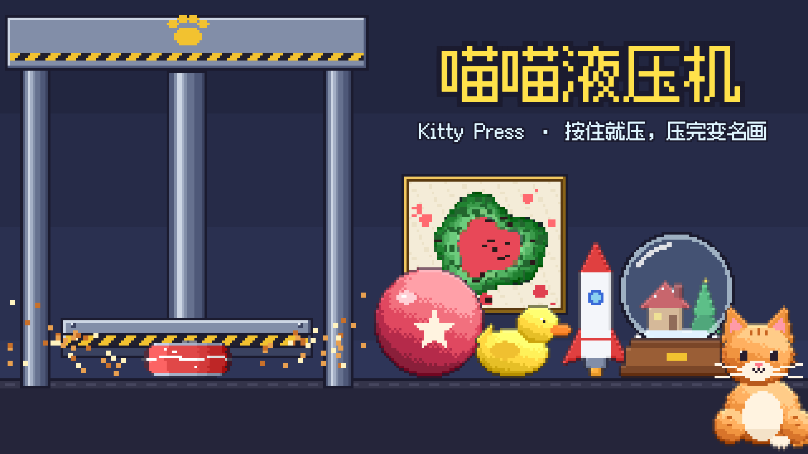

# 喵的压缩艺术 Cat Press Art

按住就压，看看它会怎么碎。

**在线试玩：** https://www.aiwanna.games/games/game-fa168b428022f28c（也可直接打开 https://grrreymane.github.io/KittyPress/）

**宣传视频：** [media/trailer.mp4](media/trailer.mp4)

## 怎么玩

- 按住屏幕（或空格 / 回车）：猫按下红按钮，液压机往下压；松手就停。
- 压碎的东西变成画，拍卖换鱼干；鱼干在「升级」里换更强的液压机，吨位越高能压的东西越多。

## 原型规格（v0.8）

- 压头空中下落最快 320 像素/秒；接触后压力按 `1.6 + 0.6 × 当前吨数` 吨/秒上升。
- 一共 100 样，能压哪些由吨位决定。没压过的按下表顺序先出，之后随机，钻石少出一些。
  - 4 吨（30 样）：汽水罐、番茄、蛋糕、橡皮鸭、鸡蛋、气球、套娃、柠檬、布丁、灯泡、甜甜圈、牙膏、泰迪熊、饭团、果冻、汉堡、冰淇淋、棉花糖、香蕉、草莓、咖啡杯、肥皂、毛线球、蜡烛、纸箱、橘子、面包、橡皮、气泡膜、钻石
  - 6 吨（23 样）：皮球、西瓜、闹钟、小星球、番茄酱、魔方、南瓜灯、冰块、菠萝、茶壶、厚书、球鞋、手机、瓷碗、鱼罐头、足球、花盆、蜂蜜罐、键盘、保温杯、台灯、篮球、西兰花
  - 10 吨（20 样）：雪景球、游戏机、存钱罐、椰子、蜡笔盒、积木、吉他、安全帽、平底锅、烤面包机、收音机、花瓶、地球仪、电饭煲、滑板、电风扇、照相机、灭火器、大鼓、行李箱
  - 16 吨（13 样）：保险箱、保龄球、陨石、铁砧、消防栓、金条、老电视、微波炉、哑铃、打字机、铁锚、骑士头盔、自行车（钻石也终于能压碎）
  - 25 吨（8 样）：轮胎、宝箱、售货机、钢琴、冰箱、摩托车、洗衣机、落地钟
  - 40 吨（6 样）：小汽车、火箭、猫雕像、巴士、飞机、飞碟

| 东西 | 怎么碎 |
|---|---|
| 汽水罐 | 约 1.7 秒压扁，压到 2/3 高时喷汽水（侧喷 + 屏幕上溅几滴） |
| 皮球 | 4.4 吨把压头弹开一次，5.4 吨炸开，压头砸到底；松手会慢慢弹回（提示「按住别松」） |
| 雪景球 | 2.5 / 5 / 7.5 吨各裂一次，9.5 吨碎开（玻璃、水、雪花），再把小房子压平 |
| 蛋糕 | 先把蜡烛撞飞，再挤出奶油和果酱；奶油粘在压头底下，抬起来后慢慢滴掉 |
| 鸡蛋 | 0.8 / 1.6 吨裂缝，2.4 吨裂开，小鸡跳出来往右跑（压头停 0.5 秒等它跑开），再压扁蛋壳 |
| 套娃 | 2.6 / 2.1 / 1.6 吨各弹开一层，上下两半飞出去，最小的一个被压扁 |
| 小星球 | 1.5 吨出熔岩裂缝，3 吨两侧火山喷发，5.5 吨炸开（月亮飞走），再压扁熔岩核 |
| 其余 92 样 | 用一套通用碎法拼出来：软 / 中 / 硬三种压缩曲线；「硬」的先在 30 / 60 / 85 % 处裂三次再碎开；气球会回弹到一定吨数再爆。碎法零件有爆汁、侧喷或往上喷、碎片、彩色糖粒、棉花、电火花、硬币（存钱罐 +40、保险箱 +200、金条 +300、售货机 +150、宝箱 +800 鱼干）、零件乱飞（齿轮、弹簧、魔方块、蜡笔、球瓶……）、响铃、发光、冒气、橡皮鸭三声嘎 |
| 钻石 | 不到 16 吨压不动：到吨位上限时过载，压头弹起、裂开，之后贴着创可贴，画按 1 鱼干「同情价」卖。16 吨时 5 吨闪光、10 吨裂纹、15 吨碎成彩虹亮片，再压平垫子，画底价 600 |

- 碎完 0.75 秒后，压扁的东西翻起来变成一幅画，镶金框放大到屏幕中间，配标题、材料·年份、喵评论家一句评语。3.6 秒后自动收进右上角「画廊」，出现 1.2 秒以后点屏幕可以提前跳过。
- **按真实材料变形**（`MAT`）。压力从上往下，所以都往两边均匀变形，不往一边歪：
  - 多汁的（水果、汉堡、果冻）：往两边鼓，侧边撕裂不齐。
  - 软的（泰迪熊、面包、棉花糖）：鼓出去摊开。
  - 像泥的（肥皂、蜡烛、金条、饭团、橡皮）：鼓出去，边上开裂。
  - 薄壳（罐子、瓶子、纸箱、家电、汽车、飞机）：一段一段折成褶，褶往外凸（汽水罐也是）。
  - 实心金属（保险箱、铁砧、哑铃、自行车）：只略微往两边鼓。
  - 易碎的（陶瓷、玻璃、石头、塑料外壳）：碎之前完全不变形，碎了以后裂成十来块，往下塌成一堆、越压越平越散。
  - 木头（吉他、宝箱、钢琴、滑板、落地钟）：同上，但裂成顺纹的长条。
  - 橡胶（气球、球、轮胎）：先鼓，爆了以后是一张皱皮。
- **画是顺着压力方向看下去的，按东西的真实结构来**：
  - 实心的软东西（番茄、汉堡、布丁）体积不变：往外摊、往外溢，顶部在正中，下面的部分一圈圈挤到外面。爆开的水果中间是蒂、然后果肉、最外面是皮。
  - 空心的盒子（冰箱、微波炉、纸箱、洗衣机）表面积不变：顶面在中间，四面墙折成一圈褶，正面最宽、还带着原来的东西（窗口、按钮）。
  - 又高又细的（番茄酱、保温杯、灯泡、灭火器）压不成正对着的一摊，会倒下去，所以保留轮廓。
  - 只在正面才有的东西（标签）留在正面，不绕一圈；不能拉伸的东西（海苔）还是一块。
  - 从上面看不是简单形状的（`TOP`：飞机、汽车、巴士、摩托车、自行车、橡皮鸭、球鞋、滑板、铁砧、平底锅、茶壶、存钱罐、饭团、蜡烛、气球、魔方）是手画的压扁后的俯视样子：管子压扁变宽约 1.5 倍，竖着的尾翼倒向一边，车轮变成长椭圆，车顶压到底、轮子挤到四角。
  - 金属有真正错开的折痕（`foldBuf`：折线外面的部分滑过来盖住里面）。
  - 只有里面有液体的才溅汁；金属、陶瓷溅的是碎片和粉末，毛绒掉的是棉絮。
- 最早那 8 样本来就是这个方向（年轮画法）。
- **背景音乐是工坊自己在打拍子**（WebAudio 合成，约 36 秒一遍）：大调、带切分，泵声当贝斯，铁砧当小铃，气阀放气，调音的金属块弹旋律，段尾一声猫叫；按住压的时候多一层棘轮声。
- **音效按材料合成**（`MS`，全部 WebAudio）：每种材料有五种声音——压头碰到、受压过程、开裂、彻底碎开、每压掉五分之一高度。金属和玻璃是不成倍数的泛音，木头敲一下就没了，多汁的咕叽往下滑，软的基本是气声，橡胶吱吱响；东西越重音越低。手机喇叭模型下最响的声音比音乐高约 11 dB。
- 画布是游戏像素的两倍细（96×80），直接画在屏幕分辨率上，不再被压回粗像素。
- 画只按一条小记录保存（种类、随机种子、摊开程度、溅了多少、松手几次），重新打开时照样画出来；最多存 90 幅。
- 每次压到一半松手，画上就多一圈「犹豫的年轮」（轮廓画里是顺着轮廓往里的一圈线，最多 4 圈）；松手 3 次以上、或者溅得特别多，评语会换成专门的一句。
- **超重的东西**：压过 8 件以后，每隔至少 4 件、约 16% 的机会，传送带送来一件下一档吨位的东西（只挑真压不动的：硬的碎裂吨数、弹性的爆开吨数、中等硬度的约 4.8 吨都高于当前吨位），带上写着「超重 · 要 N 吨」。压到吨位上限再按住 0.6 秒，压头被顶回去，「压不动！升级到 N 吨再来」，升级按钮跳三下，东西被传送带运走（不出画、不给鱼干）。这时去买到那个吨位，回来就能压。
- **一起压**：图鉴满 12 样以后，同样约 16% 的机会来两样（宽度 ≤ 46）或三样（宽度 ≤ 34）已经压过的东西并排。压头落在最高的那件上，碰到压头的才受力；软的挨着硬的，要等硬的先碎。全部压平后出一幅合画（轮廓挤在一起、上下错开），标题如「番茄和朋友们」「双人展」，卖价 = 几样底价之和 × 1.2（「合作×1.2」）× 其他倍数。
- 顶栏左上一直显示「图鉴 已压过 / 100」。画廊分「画作」「图鉴」两页：图鉴按吨位分组列出全部 100 样，压过的是彩色，已解锁没压过的是灰剪影，没解锁的是深色剪影并写「未解锁 · N 样」。
- 画廊：每页 9 幅，新的在前，点一幅看大图；打开画廊时游戏暂停。有没看过的新画时，按钮上有红点。
- 不晃屏：冲击感靠定格（0.03–0.15 秒）、白闪、粒子、音效、震动。

- 拍卖：出画 0.9 秒后叫价从 0 涨到成交价（0.5 秒），落槌。价格 = 底价 × (1 + 0.8 × 溅的程度) × 首作 2 × 名作 1.5 × 名气倍数 × 0.85–1.2。底价按吨位：4 吨 10–22，6 吨 26–45，10 吨 40–70，16 吨 160–240，25 吨 380–450，40 吨 750–900；存钱罐、保险箱另加硬币。
- 升级（左上角是鱼干，顶栏「升级」，有买得起的时候亮红点；打开时游戏暂停）：

| 升级 | 各级 | 价格 |
|---|---|---|
| 吨位 | 4 → 6 → 10 → 16 → 25 → 40 吨 | 400 / 2000 / 9000 / 25000 / 70000 |
| 加压速度 | ×1 → 1.35 → 1.8 → 2.4 → 3.2 → 4.2 | 100 / 400 / 1500 / 4000 / 15000 |
| 名气 | 画价 ×1 → 1.3 → 1.7 → 2.2 → 3 → 4 → 5.5 | 200 / 800 / 2500 / 8000 / 25000 / 60000 |

  没有「自动按」：按压是这个游戏的卖点，一定要玩家自己按。

- 节奏（机器人，按住 + 1.3 秒点掉画）：每分钟约 12 幅画；第一样升级约 15 秒，6 吨约 1–2 分钟，10 吨 5–6 分钟，16 吨 12–20 分钟，25 吨 20–25 分钟，40 吨 31–42 分钟，约 35–43 分钟全部买满。

验收项：
1. 打开后 1 秒内第一件东西到位，按钮上闪「按住屏幕」。
2. 按住时压头下降、猫眯眼按按钮；松手压头停住。
3. 一直按着，100 样东西在各自的解锁吨位下都能压完，不会卡住；一下一下点也能压完。
4. 皮球松手会弹回原形，压头跟着被顶起，按钮下提示「按住别松」。
5. 第一次压碎某样东西时，画的价钱翻倍（标「首作×2」）；八样都压过弹「全收集！」。
6. 每压完一样都出一幅画，标题和评语不重叠、不出屏；画飞进画廊按钮后，画廊里多一幅，刷新后还在，样子不变。
7. 画廊打开时压机不动；点「返回」回到原来的进度。
8. 每幅画都会拍出价钱，鱼干在落槌后涨上去；买升级马上生效（吨位提高后，新东西接着出来）。
9. 不到 16 吨，钻石让压机过载，卖 1 鱼干；16 吨时钻石能压碎。
10. 超重的东西一直按着也压不碎，0.6 秒后被运走，提示升级到几吨；升级以后同一件能压。
11. 两三样一起压时，按住和一下一下点都能全部压平，出一幅合画。

## 本地运行

整个游戏是一个 `index.html`，没有构建步骤，直接用浏览器打开即可（或 `python -m http.server` 后访问）。进度保存在浏览器本地存储里。

改了游戏里的文字后运行 `python D:/Minigame/_workflow/tools/subset_font.py .` 更新字体子集。
